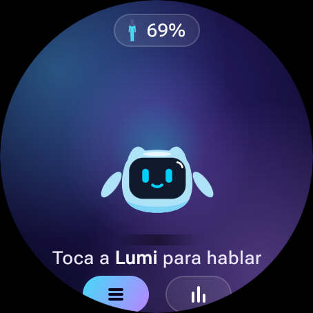
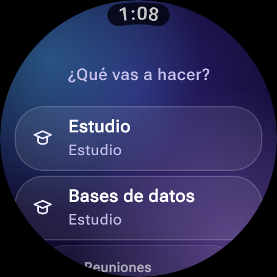
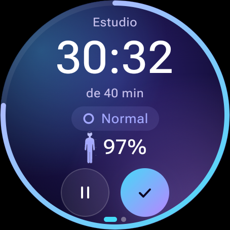
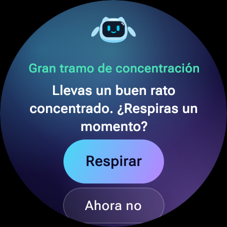
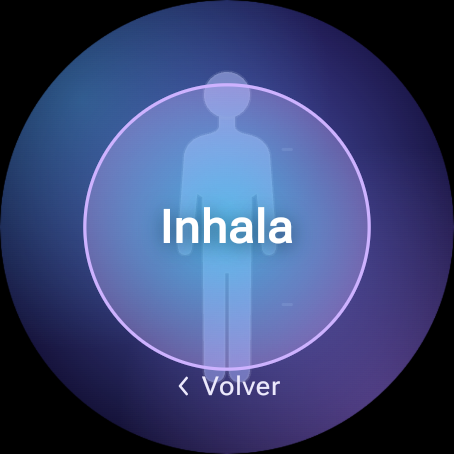
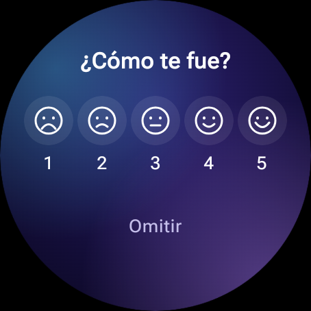
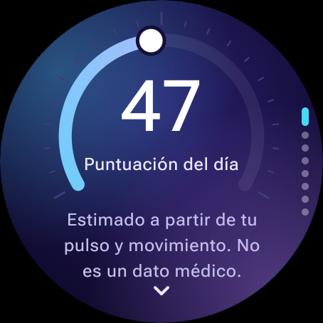
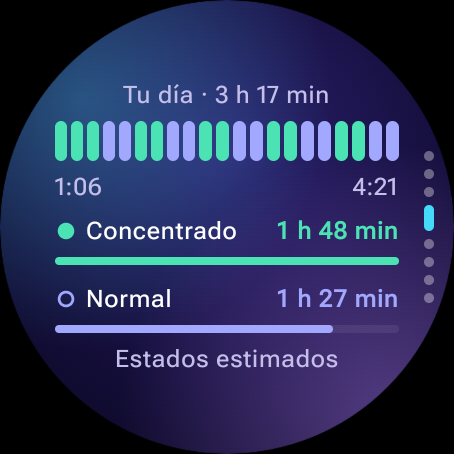

# stateAI

[English](README.md) · **Español**

**stateAI aprende en qué momentos del día rindes mejor y te dice cuánta energía estimada te queda para aprovecharlos.**

Un coach de concentración para relojes inteligentes Wear OS. Todo corre en el reloj: sin app de celular, sin servidor, sin cuentas y sin nube.

## Capturas

Emulador Wear OS Large Round, sensores simulados.

| Inicio | Actividades | Sesión | Sugerencia de pausa |
|---|---|---|---|
|  |  |  |  |

| Respiración guiada | Valoración de la sesión | Puntuación del día | Tu día |
|---|---|---|---|
|  |  |  |  |

## Por qué

Las apps tipo Pomodoro usan tiempos fijos e ignoran si estás tranquilo, cargado o inquieto. stateAI, en cambio:

1. Te pregunta "¿qué vas a hacer?" y mantiene un perfil aprendido por actividad.
2. Estima tu **nivel de activación** a partir de la frecuencia cardíaca, un proxy de variabilidad cardíaca y el movimiento.
3. Aprende con los días qué franjas horarias te funcionan mejor y si tienes un ciclo de concentración.
4. Te avisa con **micro-vibraciones** y una tarjeta en pantalla cuando conviene respirar o descansar, y aprende qué avisos aceptas para callar los que siempre rechazas.
5. Te pide una **valoración de 1 a 5** al terminar cada sesión y te muestra en qué momento del día valoras mejor tus sesiones.
6. Muestra una batería de **energía estimada** y una puntuación diaria desglosada en sus partes.
7. Tiene un inicio pensado para la voz, con una mascota, Lumi: tócala y dile qué vas a hacer.

## Limitaciones y honestidad científica

stateAI **estima**; no mide. Lee esto antes de sacar conclusiones.

- **No es un dispositivo médico.** Estima carga fisiológica y recuperación. No mide productividad, cognición ni salud, y no hace diagnósticos.
- **Sin HRV real.** Health Services de Wear OS entrega solo la frecuencia cardíaca en LPM, no los intervalos entre latidos (RR). stateAI usa un *proxy* de variabilidad cardíaca y lo llama así. Por eso el clasificador usa 3 niveles de activación en vez de pretender detectar "concentración profunda" o "agotamiento"; la etiqueta "Agotado" que se ve en pantalla es solo una combinación de sobrecarga con inquietud o poca energía estimada, no un cuarto estado medido. Detalles en [`docs/sensors.md`](docs/sensors.md).
- **Las señales de la muñeca son débiles y ruidosas.** La carga cognitiva mueve el pulso unos pocos lpm, tanto como el café, la postura o hablar. Las ventanas con mucho movimiento pesan menos o se descartan.
- **Los ciclos se descubren, no se suponen.** stateAI no asume ciclos de 90 minutos. Solo informa una duración de ciclo cuando tiene suficiente confianza y, si no, dice "Sin patrón claro", algo que se espera que sea común. Las propias vibraciones de la app podrían crear un ciclo artificial; esto está mitigado y probado.
- **Validado solo con datos simulados.** El desarrollo usa un emulador y usuarios sintéticos. La evaluación muestra que el sistema funciona de punta a punta; **no** demuestra que stateAI supere a otras técnicas en personas reales. Los datos sintéticos pueden ser circulares: un modelo puede "descubrir" lo que puso el generador. El generador usa un mecanismo distinto al del motor de reglas para reducir esto.
- **El modelo de ML es una demostración del pipeline.** Un clasificador entrenado con datos sintéticos casi solo reaprende las reglas del generador. Su valor es el pipeline Python → TFLite → Kotlin con paridad verificada y un respaldo basado en reglas, no una mayor precisión.
- **La "energía estimada" es un indicador**, derivado de los mismos datos. No es energía biológica real, y solo sugiere; nunca te bloquea.
- **La batería** aún no se ha medido en un reloj real. Muestrear el pulso de forma continua en un servicio en primer plano puede gastar la batería de forma notable.

## Voz y privacidad

La voz es opcional: la lista de actividades siempre está en el inicio, por ejemplo para empezar a
estudiar en silencio, y cualquier fallo de voz te lleva a ella.

- **Nunca continua.** El micrófono se abre solo cuando tocas a la mascota, para una petición, y se
  cierra cuando termina o tras 12 segundos de silencio.
- **No se guarda audio.** stateAI nunca graba audio por sí misma. El reconocedor devuelve texto, que se
  usa un instante para entender la petición y luego se descarta; no se guarda ni se registra.
- **Primero en el reloj.** Si el reloj tiene un reconocedor local con español instalado, se usa y
  nada sale del reloj.
- **El reconocedor del sistema, solo con tu consentimiento.** Si no, el reconocedor del sistema puede
  enviar tu voz a un servidor (por ejemplo, el de Google) para transcribirla. La primera vez, stateAI
  te lo explica y te pregunta; si lo rechazas, te quedas con la lista. El consentimiento se guarda en
  el reloj y se puede retirar borrando los datos de la app.
- **El permiso de micrófono** se pide con una explicación la primera vez; si lo rechazas, te quedas
  con la lista.
- **Todo lo demás se queda en local.** El pulso, el movimiento, los estados, la energía y el
  aprendizaje nunca salen del reloj, con o sin voz. No hay servidor ni cuenta.
- El emulador no tiene reconocedor de voz, así que las compilaciones de depuración usan texto
  escrito en su lugar.

## Estructura del proyecto

| Ruta | Contenido |
|---|---|
| `core-domain/` | Dominio en Kotlin puro: modelos, motor de reglas, aprendizaje, energía y puntuación |
| `sensors/` | Abstracción `SensorSource`, simulador y adaptador de Health Services |
| `haptics/` | Patrones hápticos y limitación de frecuencia |
| `data/` | Implementaciones con Room y DataStore de los repositorios del dominio |
| `ml/` | Envoltorio de TFLite |
| `app-wear/` | Interfaz Compose para Wear OS, ViewModels y servicio de sesión |
| `ml-python/` | Datos sintéticos, entrenamiento, exportación y evaluación |
| `build-logic/` | Plugins de convención de Gradle |
| `docs/` | Especificación y notas técnicas |

## Cómo empezar

- App de Wear OS: mira [`docs/emulator-setup.md`](docs/emulator-setup.md) y luego `./gradlew :app-wear:installDebug`.
- Herramientas de Python: mira [`ml-python/README.md`](ml-python/README.md).
- Comprobaciones: `./gradlew check` y, en `ml-python/`, `pytest`.

## Contribuir

Mira [`CONTRIBUTING.md`](CONTRIBUTING.md) para las convenciones de commits, los hooks de git y las reglas de código.
